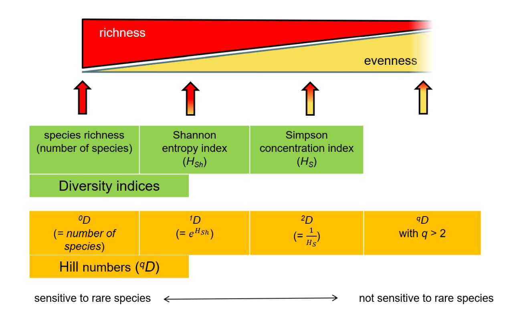

Slides desta aula

<div style="position: relative; padding-bottom: 56.25%; height: 0; overflow: hidden; max-width: 100%; border-radius: 8px; margin: 20px 0; box-shadow: 0 4px 6px rgba(0,0,0,0.1);">
  <iframe src="/slides/slides_modulo5_diversidade.html" style="position: absolute; top: 0; left: 0; width: 100%; height: 100%; border: 0;" allowfullscreen="true"></iframe>
</div>

# O problema da não-linearidade e da unidade dos índices clássicos

A mensuração da biodiversidade alfa ($\alpha$) em nível local é um dos pilares da ecologia quantitativa. por décadas, os ecólogos têm recorrido a índices sintéticos como o índice de shannon-wiener ($H'$) e o índice de simpson ($D$ ou $1-D$) para sintetizar o número de espécies (riqueza) e a distribuição de suas abundâncias relativas (equitabilidade) em um único valor numérico [1]. contudo, apesar de sua ampla utilização na literatura científica desde meados do século XX, esses índices clássicos apresentam limitações estatísticas e conceituais profundas que frequentemente levam a interpretações ecológicas equivocadas.

A principal limitação dos índices clássicos é que eles não medem a diversidade diretamente em unidades de espécies. o índice de shannon mede a entropia ou a incerteza da teoria da informação em unidades de *nats* ou *bits*, enquanto o índice de simpson mede a probabilidade de que dois indivíduos sorteados ao acaso pertençam à mesma espécie [35]. como consequência dessa natureza matemática, ambos os índices exibem um comportamento não-linear em relação às alterações na composição da comunidade.

Para ilustrar esse problema fundamental, considere o **princípio de duplicação** (*doubling property*). imagine uma comunidade florestal perfeitamente uniforme composta por 10 espécies de árvores, onde cada espécie possui exatamente a mesma abundância relativa ($p_i = 0,10$). se dividirmos essa floresta hipotética ao meio e introduzirmos no segundo fragmento outras 10 espécies inteiramente novas, com as mesmas abundâncias relativas, a intuição biológica dita que a diversidade da nova comunidade dobrou. no entanto, os índices estatísticos não refletem essa duplicação direta:

1. a riqueza de espécies ($S$) dobra de 10 para 20.

2. o índice de shannon ($H'$) aumenta de $\ln(10) \approx 2,302$ para $\ln(20) \approx 2,995$, um incremento de apenas 30%.

3. a diversidade de simpson ($1-D$) passa de $0,900$ para $0,950$, um aumento residual de apenas 5,5%.


Como $H'$ cresce de forma logarítmica e $1-D$ é assintótico próximo de 1,0, nenhum desses índices permite quantificar a magnitude percentual de ganho ou perda de biodiversidade entre diferentes ecossistemas. uma comunidade com $H' = 3,0$ não é duas vezes mais diversa do que uma comunidade com $H' = 1,5$. essa não-linearidade compromete graves análises de valoração ambiental, estudos de serviços ecossistêmicos e a formulação de políticas públicas de conservação.


---

# A unificação matemática por Mark Hill e Lou Jost

Para resolver o impasse das unidades não intuitivas e restaurar a linearidade na mensuração da biodiversidade, o ecólogo e estatístico mark hill demonstrou em 1973 que os índices clássicos de diversidade pertencem a uma mesma família de equações paramétricas baseada em médias ponderadas de abundâncias relativas. posteriormente, o físico e ecólogo lou jost (2006) formalizou essa unificação, estabelecendo o conceito de **diversidade verdadeira** (*true diversity*) ou **números de hill** ($^qD$).

A diversidade verdadeira converte qualquer índice de entropia ou probabilidade em um **número efetivo de espécies** (*effective number of species*). o número efetivo de espécies corresponde ao número de espécies igualmente abundantes (perfeitamente equitativas) que seria necessário para produzir o mesmo valor numérico do índice estatístico observado.

a fórmula geral dos números de hill para uma comunidade contendo $S$ espécies é dada pela seguinte expressão matemática:

$$^qD = \left( \sum_{i=1}^{S} p_i^q \right)^{\frac{1}{1-q}}$$

onde:
* $S$ é a riqueza total de espécies observada na comunidade.

* $p_i$ é a proporção de indivíduos pertencentes à $i$-ésima espécie ($p_i = n_i / N$).

* $q$ é o **parâmetro de ordem da diversidade**, um número real não negativo ($q \ge 0$) que atua como uma "trava de sintonia" para determinar o grau de sensibilidade do índice em relação às espécies raras ou abundantes.

Quando a fórmula dos números de hill é aplicada, o resultado é expresso estritamente em **unidades de espécies**, satisfazendo rigorosamente o princípio de duplicação: se a diversidade de um ecossistema dobra, o valor de $^qD$ é exatamente multiplicado por 2.

---

# A família de números de Hill e a ordem $q$

o parâmetro $q$ permite explorar a estrutura da comunidade em três pontos-chave ou ordens principais ($q = 0, q = 1, q = 2$), refletindo a transição gradual do foco das espécies raras para as espécies dominantes.

| Ordem ($q$) | Denominação | Expressão matemática de conversão | Sensibilidade às abundâncias relativas | Interpretação ecológica |
| :--- | :--- | :--- | :--- | :--- |
| **$q = 0$** | **Riqueza de espécies** | $^0D = S$ | Totalmente insensível (todas as espécies têm peso igual a 1) | Número total de espécies observadas no local |
| **$q = 1$** | **Espécies típicas / freqüentes** | $^1D = \exp(H') = \exp\left(-\sum p_i \ln p_i\right)$ | Ponderação proporcional exata às abundâncias relativas | Número de espécies abundantes/comuns na comunidade |
| **$q = 2$** | **Espécies dominantes** | $^2D = \frac{1}{D} = \frac{1}{\sum p_i^2}$ | Ponderação desproporcional para espécies muito abundantes | Número de espécies altamente dominantes |

### Número de Hill de ordem zero ($q = 0$)
para $q = 0$, o expoente $q$ anula o efeito das abundâncias relativas ($p_i^0 = 1$ para todo $p_i > 0$). a equação simplifica-se para:

$$^0D = \sum_{i=1}^{S} 1 = S$$

a diversidade de ordem zero ($^0D$) é simplesmente a riqueza observada de espécies. ela atribui o mesmo peso tanto a uma espécie hiperdominante representada por 90% dos indivíduos quanto a uma espécie rara representada por apenas um indivíduo amostrado (*singleton*).

### Número de Hill de ordem um ($q = 1$)
quando $q \to 1$, o termo $1 / (1-q)$ na fórmula geral torna-se indefinido. contudo, aplicando o limite matemático de l'hôpital quando $q$ se aproxima de 1, a equação converte-se exatamente na exponencial da entropia de shannon-wiener ($H'$):

$$^1D = \lim_{q \to 1} ^qD = \exp\left(-\sum_{i=1}^{S} p_i \ln(p_i)\right) = \exp(H')$$

a diversidade verdadeira de ordem um ($^1D$) pesa cada espécie em proporção exata à sua abundância na comunidade. ela pode ser interpretada biologicamente como o número de espécies "típicas" ou "frequentes" no ecossistema. se uma comunidade possui $H' = 2,302$, sua diversidade verdadeira é $^1D = \exp(2,302) = 10,0$ espécies efetivas.

### Número de Hill de ordem dois ($q = 2$)
para $q = 2$, a fórmula pondera as abundâncias de forma quadrática ($p_i^2$), reduzindo a contribuição das espécies raras a valores negligenciáveis. a equação reduz-se ao inverso do índice de dominância de simpson ($D$):

$$^2D = \frac{1}{\sum_{i=1}^{S} p_i^2} = \frac{1}{D}$$

a diversidade verdadeira de ordem dois ($^2D$) mede o número de espécies "muito abundantes" ou "dominantes" na comunidade. se o índice de dominância de simpson de um local for $D = 0,25$, sua diversidade de ordem dois será $^2D = 1 / 0,25 = 4,0$ espécies efetivas dominantes.

---

# Perfil continuado de diversidade de hill

em vez de analisar $q = 0, q = 1, q = 2$ isoladamente, lou jost e anne chao demonstraram que é possível calcular $^qD$ para um espectro contínuo de valores de $q$ (por exemplo, de $q = 0$ até $q = 3$), gerando o chamado **perfil de diversidade de hill** (*hill diversity profile*).


a geometria e a inclinação da curva do perfil de diversidade de hill fornecem uma caracterização visual completa da estrutura de abundância da comunidade:

1. **curva estritamente horizontal ($^0D = ^1D = ^2D = S$):** indica uma comunidade com equitabilidade perfeita ($J' = 1,0$), onde todas as espécies possuem exatamente o mesmo número de indivíduos.
2. **curva com declive suave:** indica uma comunidade moderadamente equitativa, com pouca dominância.
3. **curva com declive acentuado (queda brusca de $q=0$ para $q=2$):** reflete uma comunidade com alta hiperdominância de poucas espécies e grande quantidade de espécies raras.

portanto, a variação relativa entre $^0D$, $^1D$ e $^2D$ permite isolar o efeito da equitabilidade sem a necessidade de calcular índices acessórios adicionais como o $J'$ de pielou.

---

# Exemplo numérico resolvido passo a passo

para consolidar o entendimento da conversão de índices brutos em números efetivos de espécies, considere três comunidades hipotéticas (saco a, saco b e saco c), cada uma amostrada com exatamente 100 indivíduos ($N = 100$):

* **comunidade a (hiperdominante):** 4 espécies. $n_1 = 85, n_2 = 10, n_3 = 4, n_4 = 1$.
* **comunidade b (desigual moderada):** 4 espécies. $n_1 = 50, n_2 = 30, n_3 = 15, n_4 = 5$.
* **comunidade c (perfeitamente uniforme):** 4 espécies. $n_1 = 25, n_2 = 25, n_3 = 25, n_4 = 25$.

### passo 1: cálculo das proporções relativas ($p_i$)
* **comunidade a:** $p_1 = 0,85; p_2 = 0,10; p_3 = 0,04; p_4 = 0,01$.
* **comunidade b:** $p_1 = 0,50; p_2 = 0,30; p_3 = 0,15; p_4 = 0,05$.
* **comunidade c:** $p_1 = 0,25; p_2 = 0,25; p_3 = 0,25; p_4 = 0,25$.

### passo 2: cálculo dos índices estatísticos clássicos
* **shannon ($H'$):**
  * $H'_A = -[0,85\ln(0,85) + 0,10\ln(0,10) + 0,04\ln(0,04) + 0,01\ln(0,01)] = 0,544$.
  * $H'_B = -[0,50\ln(0,50) + 0,30\ln(0,30) + 0,15\ln(0,15) + 0,05\ln(0,05)] = 1,145$.
  * $H'_C = -4 \times [0,25\ln(0,25)] = \ln(4) = 1,386$.

* **dominância de simpson ($D = \sum p_i^2$):**
  * $D_A = 0,85^2 + 0,10^2 + 0,04^2 + 0,01^2 = 0,7225 + 0,0100 + 0,0016 + 0,0001 = 0,734$.
  * $D_B = 0,50^2 + 0,30^2 + 0,15^2 + 0,05^2 = 0,2500 + 0,0900 + 0,0225 + 0,0025 = 0,365$.
  * $D_C = 4 \times (0,25^2) = 4 \times 0,0625 = 0,250$.

### passo 3: conversão para números de hill ($^qD$)

| Comunidade | Riqueza ($^0D = S$) | Shannon ($H'$) | Diversidade de Shannon ($^1D = \exp(H')$) | Simpson ($D$) | Inverso de Simpson ($^2D = 1/D$) |
| :--- | :---: | :---: | :---: | :---: | :---: |
| **Comunidade A** | 4 | 0,544 | **1,72 espécies** | 0,734 | **1,36 espécies** |
| **Comunidade B** | 4 | 1,145 | **3,14 espécies** | 0,365 | **2,74 espécies** |
| **Comunidade C** | 4 | 1,386 | **4,00 espécies** | 0,250 | **4,00 espécies** |

### Interpretação ecológica dos números de hill obtidos
1. **comunidade a:** embora possua 4 espécies físicas ($^0D = 4$), a forte dominância da espécie 1 (85%) faz com que ela funcione biologicamente como se contivesse apenas **1,72 espécies equivalentes comuns** ($^1D$) e **1,36 espécies equivalentes dominantes** ($^2D$).
2. **comunidade b:** com uma distribuição moderadamente desigual, seus 4 táxons correspondem a **3,14 espécies efetivas comuns** e **2,74 espécies efetivas dominantes**.
3. **comunidade c:** como a distribuição é perfeitamente uniforme, todas as três ordens de hill coincidem exatamente ($^0D = ^1D = ^2D = 4,00$).

---

# Decomposição multiplicativa da diversidade gama em alfa e beta

Outra vantagem crucial dos números de hill é a resolução da partição espacial da biodiversidade regional (diversidade gama, $^\gamma D$). whittaker (1960) propôs originalmente que a diversidade gama é o produto da diversidade local (alfa, $^\alpha D$) pela renovação de espécies entre locais (beta, $^\beta D$):

$$^\gamma D = ^\alpha D \times ^\beta D \implies ^\beta D = \frac{^\gamma D}{^\alpha D}$$

Quando aplicada aos índices brutos de shannon ou simpson, essa relação multiplicativa falha matematicamente porque os índices não são lineares. contudo, Jost (2006) provou que quando $^\alpha D$, $^\beta D$ e $^\gamma D$ são expressos em números de hill, a **decomposição multiplicativa de whittaker é rigorosamente válida e consistente para qualquer ordem $q$** [133, 146].

nesta abordagem:

* **$^\alpha D$ (alfa verdadeira):** número efetivo médio de espécies por comunidade local.

* **$^\gamma D$ (gama verdadeira):** número efetivo total de espécies no conjunto regional de comunidades.

* **$^\beta D$ (beta verdadeira):** número efetivo de comunidades completamente distintas na região.

O valor de $^\beta D$ varia entre $1,0$ (quando todas as comunidades possuem exatamente a mesma composição e abundância relativa de espécies) e $N$ (quando todas as $N$ comunidades são inteiramente distintas e não compartilham nenhuma espécie).

---

# Aplicação prática no r com pacotes vegan e inext

no ambiente r, o cálculo dos números de hill e a construção dos perfis de diversidade podem ser realizados com os pacotes `vegan` e `iNEXT` [2, 131].

### script r para cálculo dos números de hill e perfis
```r
# carregamento dos pacotes necessários
library(vegan)
library(tidyverse)
library(iNEXT)

# 1. matriz de abundâncias simuladas dos sacos de lego
lego_mat <- matrix(c(
  70, 15,  8,  4,  2,  1,  0,  0,  0,  0,  # Saco A (Hiperdominante)
  40, 22, 14, 10,  6,  4,  3,  1,  0,  0,  # Saco B (Log-normal)
  10, 10, 10, 10, 10, 10, 10, 10, 10, 10,  # Saco C (Uniforme)
  30, 18, 12,  8,  6,  4,  3,  3,  2,  2   # Saco D (Muitas raras)
), nrow = 4, byrow = TRUE)

rownames(lego_mat) <- c("Saco_A", "Saco_B", "Saco_C", "Saco_D")
colnames(lego_mat) <- paste0("Cor_", 1:10)

# 2. cálculo automatizado das três ordens de Hill (q=0, q=1, q=2)
calc_hill <- function(mat) {
  q0 <- rowSums(mat > 0)                                   # q=0: Riqueza (S)
  H  <- diversity(mat, index = "shannon")
  q1 <- exp(H)                                              # q=1: exp(Shannon)
  D  <- rowSums((mat / rowSums(mat))^2)
  q2 <- 1 / D                                               # q=2: Inv. Simpson
  
  data.frame(
    Comunidade = rownames(mat),
    q0_Riqueza = q0,
    q1_Exponencial_Shannon = round(q1, 2),
    q2_Inverso_Simpson = round(q2, 2)
  )
}

tabela_hill <- calc_hill(lego_mat)
print(tabela_hill)

# 3. rarefação e perfil continuo via pacote iNEXT
inext_out <- iNEXT(t(lego_mat), q = c(0, 1, 2), datatype = "abundance")
g_profile <- ggiNEXT(inext_out, type = 1) + 
  theme_minimal() + 
  labs(title = "rarefação e extrapolação de hill (q=0, q=1, q=2)",
       x = "tamanho da amostra (número de peças)", y = "diversidade verdadeira (^qD)")

print(g_profile)
```

---

# Implicações para conservação e monitoramento ambiental

A adoção dos números de hill no monitoramento ambiental e nos estudos de impacto ambiental (EIA/RIMA) representa um avanço metodológico fundamental:

1. **comunicação clara com tomadores de decisão:** relatórios técnicos podem afirmar diretamente que *"a restauração florestal aumentou a diversidade verdadeira do sítio de 3,2 para 8,5 espécies efetivas"*, em vez de relatar variações abstratas de entropia de $H' = 1,16$ para $H' = 2,14$.
2. **comparabilidade entre biomas:** permite comparar a diversidade de florestas tropicais, savanas e sistemas aquáticos na mesma escala métrica linear.
3. **detecção precoce de perda de biodiversidade:** quedas acentuadas na diversidade de ordem dois ($^2D$) indicam a proliferação de espécies invasoras hiperdominantes antes mesmo que ocorra a extinção local de espécies raras ($^0D$).

---

# Referências bibliográficas

1. Begon, M.; Townsend, C. R.; Harper, J. L. *Ecologia: de Indivíduos a Ecossistemas*. 4ª ed. Porto Alegre: Artmed, 2007.
2. Chao, A.; Gotelli, N. J.; Hsieh, T. C.; Sander, E. L.; Ma, K. H.; Colwell, R. K.; Jost, L. *Rarefaction and extrapolation with Hill numbers: a framework for sampling and estimation in species diversity studies*. Ecological Monographs, v. 84, n. 1, p. 45-67, 2014.
3. Da Silva, F. R.; Gonçalves-Souza, T.; Paterno, G. B.; Provete, D. B.; Vancine, M. H. *Análises Ecológicas no R*. Recife: Nupeea, 2022.
4. Hill, M. O. *Diversity and evenness: a unifying notation and its consequences*. Ecology, v. 54, n. 2, p. 427-432, 1973.
5. Jost, L. *Entropy and diversity*. Oikos, v. 113, n. 2, p. 363-375, 2006.
6. Ricklefs, R. E.; Relyea, R. *A Economia da Natureza*. 7ª ed. Rio de Janeiro: Guanabara Koogan, 2016.
7. Whittaker, R. H. *Vegetation of the Great Smoky Mountains*. Ecological Monographs, v. 26, n. 1, p. 1-80, 1956.