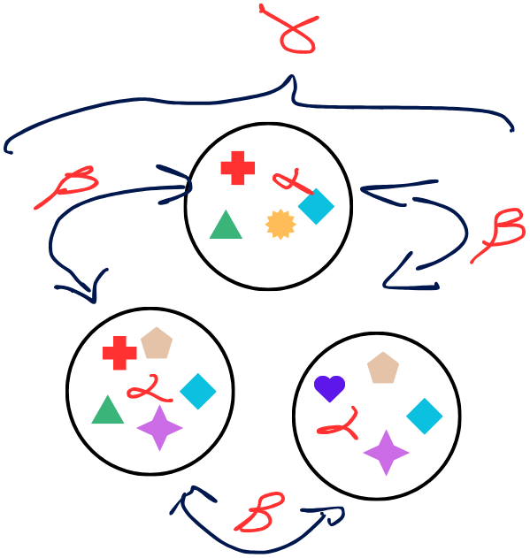
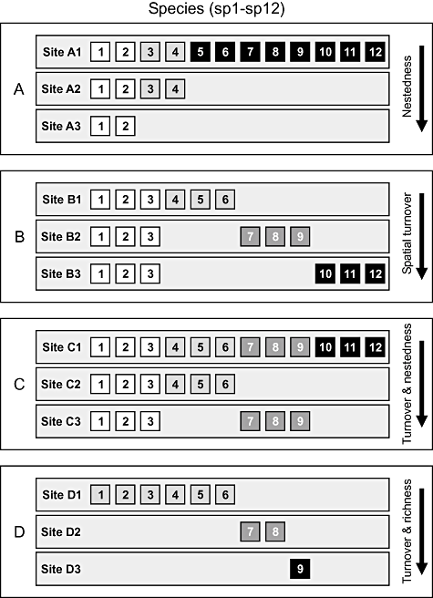

```{r}
#| message: false
#| warning: false
#| include: false
library(tidyverse)
```


## Introdução à diversidade beta

::: {.columns}
::: {.column width="50%"}
- diversidade beta ($beta$) mede a variação na composição de espécies
- conecta a riqueza local ($alpha$) à diversidade regional ($\gamma$).
- essencial para identificar processos causais na montagem de comunidades.

:::

::: {.column width="50%"}

:::
:::

##


## 


##


##


##


## Partição da diversidade: multiplicativa vs. aditiva

::: {.columns}
::: {.column width="50%"}
- partição multiplicativa: $\beta_W = \frac{\gamma}{\bar{\alpha}}$
- partição aditiva:$\gamma = \bar{\alpha} + \beta_A \implies \beta_A = \gamma - \bar{\alpha}$
- a partição aditiva mantém todas as componentes na mesma unidade física (número de espécies).
- facilita a comparação entre escalas espaciais hierárquicas.
:::

::: {.column width="50%"}
{width=60%}

:::
:::


## Jaccard e Sørensen (pres/aus)

::: {.columns}
::: {.column width="50%"}
- baseados no número de espécies compartilhadas ($a$) e exclusivas ($b, c$).
- dissimilaridade de Jaccard: $Jac = (b + c) / (a + b + c)$
- dissimilaridade de Sørensen: $Sor = (b + c) / (2a + b + c)$.
:::

::: {.column width="50%"}

:::
:::

## 


## Duplos zeros


## Dissimilaridade para dados quantitativos

::: {.columns}
::: {.column width="50%"}
- incorpora a abundância relativa ou biomassa de cada espécie.
- sensível a mudanças na dominância ecológica, mesmo quando as espécies são as mesmas.
- Bray-Curtis é o índice quantitativo mais utilizado na literatura ecológica internacional.
:::

::: {.column width="50%"}

:::
:::


## Decomposição da diversidade beta: turnover vs. aninhamento

::: {.columns}
::: {.column width="50%"}

- **substituição** (*turnover*): troca de espécies entre locais por restrição de nicho/ambiente.
- **aninhamento** (*nestedness*): comunidades mais pobres são subconjuntos estritos das comunidades mais ricas.
- Prtição: $\beta_{sor} = \beta_{sim} + \beta_{nes}$
:::

::: {.column width="50%"}
```{r}
#| echo: false
#| fig-height: 5
baselga_df <- data.frame(
  Processo = c("Turnover (Substituição)", "Nestedness (Aninhamento)"),
  Proporção = c(0.72, 0.28)
)
ggplot(baselga_df, aes(x = "", y = Proporção, fill = Processo)) +
  geom_col(width = 0.5) +
  scale_fill_manual(values = c("#d35400", "#27ae60")) +
  theme_minimal(base_size = 14) +
  labs(title = "decomposição da diversidade beta (baselga)", x = "", y = "proporção da dissimilaridade")
```
:::
:::

## Implicações da partição da diversidade beta para conservação

::: {.columns}
::: {.column width="50%"}
- Quando dominada por turnover:
  - alta substituição espacial de espécies.
  - estratégia: proteger múltiplos fragmentos ao longo de todo o gradiente.
- Se dominada por aninhamento:
  - perda sequencial de espécies.
  - estratégia: focar recursos na proteção do maior e mais rico fragmento.
:::

::: {.column width="50%"}

:::
:::

## Introdução às técnicas de ordenação multidimensional

::: {.columns}
::: {.column width="50%"}
- reduzem a complexidade de matrizes de alta dimensionalidade (muitas espécies).
- projetam os locais em um espaço gráfico bidimensional contínuo.
- locais representados próximos no gráfico possuem composição ecológica semelhante.
- locais distantes possuem composição altamente dissimilar.
:::

::: {.column width="50%"}
```{r}
#| echo: false
#| fig-height: 8
set.seed(42)
ord_demo <- data.frame(Eixo1 = rnorm(10), Eixo2 = rnorm(10), Grupo = rep(c("Sítio A", "Sítio B"), each = 5))
ggplot(ord_demo, aes(x = Eixo1, y = Eixo2, color = Grupo)) +
  geom_point(size = 5) +
  theme_minimal(base_size = 14) +
  scale_color_manual(values = c("#e74c3c", "#3498db")) +
  labs(title = "conceito de diagrama de ordenação", x = "eixo de ordenação 1", y = "eixo de ordenação 2")
```
:::
:::


## Escalonamento multidimensional não-métrico (NMDS)

::: {.columns}
::: {.column width="50%"}
- a técnica de ordenação mais popular e robusta para dados biológicos não-normais.
- preserva o ranqueamento das distâncias ecológicas entre pares de amostras.
- não assume relações lineares entre abundâncias e variáveis ambientais.
- implementado no R pela função `metaMDS()` do pacote `vegan`.
:::

::: {.column width="50%"}
```{r}
#| echo: false
#| fig-height: 5
library(vegan)
data(dune)
nmds <- metaMDS(dune, trace = 0)
nmds_df <- data.frame(NMDS1 = nmds$points[,1], NMDS2 = nmds$points[,2])
ggplot(nmds_df, aes(x = NMDS1, y = NMDS2)) +
  geom_point(size = 4, color = "#2c3e50") +
  theme_minimal(base_size = 14) +
  labs(title = paste("ordenação NMDS (dune) - stress:", round(nmds$stress, 3)), x = "NMDS 1", y = "NMDS 2")
```
:::
:::

## Interpretando o valor de stress no NMDS

::: {.columns}
::: {.column width="50%"}
- o stress quantifica o desacordo entre as distâncias reais e as distâncias no gráfico.
- stress $< 0,05$: excelente representação bidimensional.
- stress $< 0,10$: boa representação; conclusões muito confiáveis.
- stress $< 0,20$: razoável; aceitável para dados ecológicos complexos.
- stress $> 0,20$: representação não confiável (aumentar eixos para $k=3$).
:::

::: {.column width="50%"}
```{r}
#| echo: false
#| fig-height: 5
stress_df <- data.frame(
  Classificação = c("Excelente (<0.05)", "Boa (<0.10)", "Razoável (<0.20)", "Ruim (>0.20)"),
  Limite = c(0.05, 0.10, 0.20, 0.30)
)
ggplot(stress_df, aes(x = Classificação, y = Limite, fill = Classificação)) +
  geom_col(width = 0.5, show.legend = FALSE) +
  scale_fill_manual(values = c("#27ae60", "#2980b9", "#f39c12", "#c0392b")) +
  theme_minimal(base_size = 14) +
  labs(title = "escala de qualidade de stress no NMDS", y = "valor limite de stress", x = "")
```
:::
:::


## Agrupamento hierárquico (cluster analysis) e dendrogramas

::: {.columns}
::: {.column width="50%"}
- agrupa amostras em uma estrutura hierárquica em árvore (dendrograma).
- excelente para identificar grupos discretos de comunidades e ecótonos.
- complementa as ordenações contínuas (NMDS/PCoA).

:::

::: {.column width="50%"}
```{r}
#| echo: false
#| fig-height: 7
library(vegan)
data(dune)
d <- vegdist(dune, "bray")
hc <- hclust(d, method = "average")
plot(hc, main = "dendrograma UPGMA (dune)", xlab = "amostras", sub = "")
```
:::
:::


## FIM {.center}